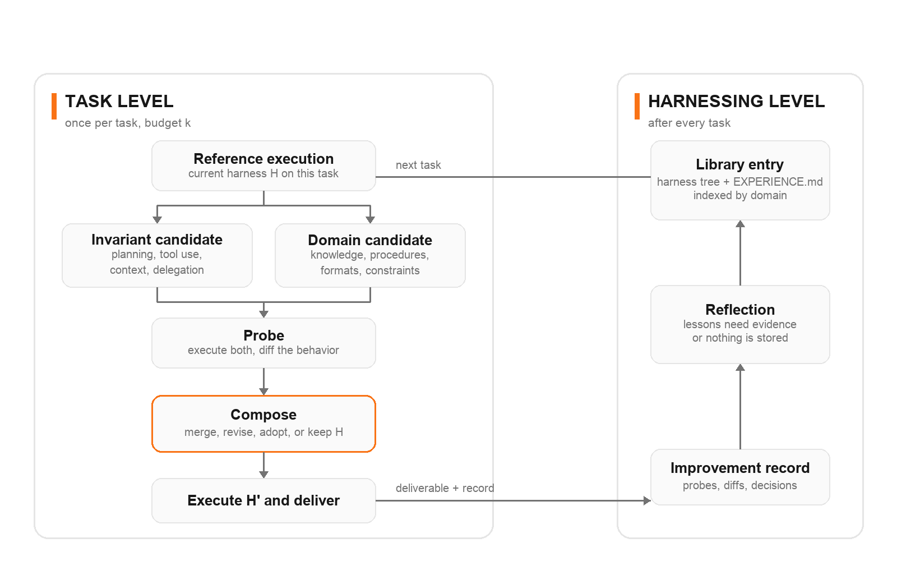

Every few weeks someone announces that the model was never the point. This time it came with a repository, a paper, and 10,014 stars in thirteen days. Harness² is Google Research's answer to a question that quietly decides whether your agent works: if the model is frozen, can the scaffolding around it improve itself, on tasks nobody trained it for, with no grader to tell it whether it was right?

The paper's claim is narrow and testable. One contrastive editing step raises scores on three professional benchmarks and four model and harness combinations, and more steps raise them further. I cloned the repo, read the core, and ran the credential-free demo on a MacBook. The run took 1.6 seconds and exposed one bug, two totals and one stored lesson, which is a better explanation of the method than the abstract.

## The layer everyone tunes by hand

A harness is everything that turns a model into an agent: the system prompt, the guardrails, the memory file, the skills it can load, the tool guidance, the scripts it runs, the subagents it delegates to, and the plugin hooks that sit in the tool loop. The paper uses one line for it: agent equals model plus harness. Harnessing is the work of optimizing that second term.

That work is usually a person editing files after watching a trace go wrong. Harness² makes it a loop with two levels, and the split is the whole idea:

| Level | What changes | When |
|---|---|---|
| Task-level recursion | The execution harness for the task in front of it | Within the task, bounded by a budget k |
| Harnessing-level recursion | The improvement harness, meaning the library of adopted harnesses and lessons | After the task, before the next one |

The execution harness is the system being improved. The improvement harness is the mechanism that improves it, and it never changes weights either. The next task still starts from the same base harness. What carries forward is the library.



*One task, two loops. The model is frozen on both sides of the arrow.*

The result people will quote is that a weaker model with a better harness beat a stronger model with a stock one. On WorkBuddy-Bench, GLM-5 under OpenCode went from 64.2 to 75.7 after one step, while Gemini 3.5 Flash, a stronger executor, sat at 72.4 with its unmodified harness. That single number is the argument for treating harness engineering as a first-class job rather than prompt polishing.

## Propose, Probe, Compose without a grader

The hard part is not editing files. It is knowing which edit helped when nobody can tell you the right answer. Benchmarks have rubrics; your production tasks do not. The paper's answer is a contrastive step that never asks whether an output is correct.

1. **Propose.** Run the current harness on the task once and keep the trajectory as a reference. Then an editor proposes two candidate harnesses from the task, the current harness, that reference, the task history and the library. One candidate is **invariant**: it targets things like planning, tool use, context management or delegation that recur across domains. The other is **domain-specific**: it targets the knowledge, procedures and constraints of this kind of work.
2. **Probe.** Execute both candidates on the same task under matched model and environment settings, and diff their behavior against the reference. That diff is the **behavioral contrast**. It is evidence that an edit changed the thing it aimed at, or did not.
3. **Compose.** A composer reads the reference, both candidates, their diffs and all task-local evidence, then merges supported changes, revises conflicts, adopts one candidate, or keeps the current harness. Every decision has to point at an observation, not a presumed score gain.

Then the composed harness is executed, and the whole record (reference, candidates, probes, decisions, result) is what reflection reads afterwards.

Two details make this more careful than it first sounds. The selector that picks among final candidates compares anonymized deliverables and never sees which harness produced which, so it cannot reward its own edit. And the adopted harness is marked with a star that the paper explicitly defines as adopted, not optimal. There is no claim that the loop found the best harness, only that it found one supported by evidence it could see.

`k` is how you spend more: at `k=5` in parallel mode the pipeline probes 5 invariant and 5 domain candidates, then runs 5 independent compositions over the shared pool. In sequential mode it chains 5 complete steps, each carrying the refined harness and the accumulated evidence into the next. Parallel explores wider, sequential refines deeper, and the release supports both.

## The eight files it is allowed to touch

Every component is a file, so every edit is a diff that can be validated, stored and replayed. That single design choice is why the library can hold executable harnesses instead of prose summaries.

| Component | File | Reaches the model |
|---|---|---|
| System prompt | `systemprompt.md` | every call |
| Guardrails | `guardrails.md` | every call |
| Memory | `LongTermMEMORY.md` | every call |
| Tool guidance | `tool_descriptions/tool_guidance.md` | every call |
| Skills | `skills/<n>/SKILL.md` plus its scripts | on demand, through the skill tool |
| Scripts | `scripts/<name>.py` | run through bash |
| Subagents | `sub_agents/<n>/AGENT.md` | through the task tool, in their own context |
| Plugin | `plugin/<name>.ts` | inside the tool loop, at turn boundaries |

The stock harness ships with these files empty apart from the benchmark's own instructions, plus a placeholder in each on-demand directory. The placeholder exists so the editor can discover that the lever is there. The paper extends an earlier file-level decomposition (AHE) by one component, the middleware plugin, which is the only one that enforces behavior rather than instructing it.

## I ran it: one bug, two totals, one stored lesson

The README asks for Linux, Python 3.12 and uv. I used macOS and it worked, which is worth knowing because the package metadata only classifies POSIX.

```bash
uv venv --python 3.12 .venv
source .venv/bin/activate
uv pip install -e .
harness2-demo --output runs/demo --k 2
```

Two tasks, both modes, `k=2`: exit 0 in **1.649 seconds**, `execution_count: 28`, `editor_calls: 32`. No model calls, no credentials, no spend.

The demo is a two-task accounting domain, and the base harness contains a real bug. `scripts/summarize.py` sums a CSV of signed amounts but filters the negatives out:

```python
amounts = [Decimal(row['amount']) for row in csv.DictReader(source)]
total = sum((amount for amount in amounts if amount > 0), Decimal(0))
```

So credits vanish. The scripted editor deletes ` if amount > 0`, the probe re-runs the same task, and the composer keeps the change. What came out:

| Task | Ledger rows | Base output | Refined output | Correct |
|---|---|---|---|---|
| ledger-1 | 100.25, -20.10, 5.00 | Total: 105.25 | Total: 85.15 | 85.15 |
| ledger-2 | 35.50, -10.25, -5.00 | Total: 35.50 | Total: 20.25 | 20.25 |

The library entry is the part worth reading, because it is what makes the second task cheaper than the first. Each task writes a directory containing the full adopted harness tree plus an `EXPERIENCE.md`:

```markdown
## Transferable lesson
- **cue**: When a ledger includes credits and debits
- **lesson**: Include both signs when summing in scripts/summarize.py.
- **evidence**: The scripts/summarize.py row, removing the positive-only filter
  changed the probe total to include the credits omitted by the base trajectory.
- **confidence**: high for this observed arithmetic contrast
```

The domain index lists both entries under the same cue, so the next task's Propose step can find a harness that already solved this class of problem. On the second task, `library_entries_before` was 1 for each mode.

Be clear about what this proves. The recursion, the tree validation, the library, the anonymized selection, the ledger and the subprocess executions are all real code, and the fix is verified by real execution. But `DemoProposer` is scripted: it already knows the bug. The demo demonstrates the plumbing of the method, not that a model can find a bug like this unaided. For that, the paper is the evidence, and the paper's editor is a model.

## What the published numbers actually say

WorkBuddy-Bench, macro average across Code, Web and Office, mean and standard deviation over three streams, test halves of 40, 35 and 25 tasks:

| Executor and initial harness | Base | Harness² at k=1 | Parallel recursion at k=5 |
|---|---|---|---|
| Gemini 3.5 Flash, OpenCode | 72.4 (0.9) | 77.5 (2.5) | +3.3 |
| Gemini 3.5 Flash, Codex | 74.5 (1.6) | 77.5 (2.0) | +2.9 |
| GLM-5, OpenCode | 64.2 (1.4) | 75.7 (2.2) | +3.9 |
| GLM-5, Codex | 64.4 (1.2) | 75.3 (1.3) | +3.0 |

JobBench (34 test tasks, weighted rubric) and LAB (100 test tasks, partial pass rate):

| Executor and harness | JobBench base | k=1 | +k=5 | LAB base | k=1 | +k=5 |
|---|---|---|---|---|---|---|
| Gemini 3.5 Flash, OpenCode | 31.5 | 36.0 | +3.0 | 79.9 | 81.9 | +2.6 |
| GLM-5, OpenCode | 20.6 | 24.2 | +4.2 | 59.6 | 71.4 | +6.7 |
| Gemini 3.5 Flash, Codex | 33.9 | 35.3 | +4.2 | 71.6 | 75.6 | +2.9 |
| GLM-5, Codex | 23.6 | 24.8 | +3.1 | 58.1 | 65.9 | +4.8 |

Four reading notes, because the summary of those tables is where most coverage will stop.

**The biggest gains belong to the weaker model.** The +11.5 on WorkBuddy, +4.5 on JobBench and +11.8 on LAB are all GLM-5 numbers. Gemini 3.5 Flash gains 5.1 on WorkBuddy and 4.5 on JobBench, and only 2.0 on LAB. Harness refinement is closing a deficit, not raising a ceiling for a model that is already strong. That is still a useful result, arguably a more useful one, but it is a different claim from "this makes your agent better".

**The editor is stronger than the executor in the main tables.** Most configurations use Claude Opus 4.8 as the editor and selector while the executor is Gemini 3.5 Flash or GLM-5. The paper addresses this directly: with the same model in both roles at `k=2`, all five models improved on every benchmark. Opus 5 gained 3.3 on WorkBuddy, 5.5 on JobBench and 3.0 on LAB; GLM-5 gained 13.7 on LAB, more than its `k=1` gain. You do not need a smarter editor to get a gain, though a smarter editor still buys one.

**It does not win every cell.** Meta-Harness, an offline method that searches harness code against a training split, leads LAB partial for Gemini 3.5 Flash under Codex at `k=1`, with 76.5 against 75.6. Harness² takes that cell back at `k=5`. On WorkBuddy and JobBench it beats every baseline in all four configurations.

**The ablations say the library is not decoration.** On WorkBuddy and JobBench with Gemini 3.5 Flash under OpenCode at `k=1`: removing the library costs 3.1 and 1.8 points, removing the invariant and domain scoping costs 2.9 and 3.7, removing composition costs 1.6 and 1.9. Removing components from an already improved harness costs more: skills 5.3, scripts 3.7, the prompt group 1.5 on WorkBuddy. Every ablated harness still beat the base, so the gains are distributed rather than carried by one trick.

Two more results matter if you plan to borrow the idea. A harness refined for Gemini 3.5 Flash and applied unchanged to GLM-5 moved WorkBuddy Code from 58.5 to 75.8, so an adopted harness can transfer across models. And against unmodified production harnesses, no fixed harness wins all three domains: Claude Code wins Code and Office, Codex wins Web, while Harness² from OpenCode at `k=5` beats the best fixed harness by 4.6, 5.8 and 4.9 points.

## What it costs, and why the budget is a formula

The repo's ledger asserts a budget identity per task per mode, and raises if a run does not land on it:

```python
def expected_rollouts(k: int) -> int:
    """R = 4k: k shared base + 2k candidates + k finals."""
    return 4 * int(k)

def expected_sessions(k: int) -> int:
    """P = 3k: k INV + k DOM + k compositions."""
    return 3 * int(k)
```

So the cost of one task at budget `k` is 4k rollouts plus 3k editor sessions, plus one selection and one reflection session. It is predictable before you start, which is more than most agent loops can say. My demo run matched it exactly: 2 shared base executions per task, 6 stages per mode, 1 selection and 1 reflection per mode, which is 28 executions and 32 sessions for two tasks.

The paper reports the trade-off as a Pareto frontier over total tokens spent before the deliverable: at `k=1` to `k=5`, Gemini 3.5 Flash under OpenCode moves from 4.5 to 7.5 points over base on JobBench and from 5.1 to 8.4 on WorkBuddy, and both Harness² configurations sit on the frontier. Meta-Harness spends more tokens than Harness² at `k=5` for less score. Parallel proposal and composition sessions can run concurrently, so latency can be much lower than the token count suggests, depending on how much concurrency you have.

The missing control is a spend cap. There is no `--max-usd` flag, only an open request for one, and running the real benchmarks means paying for every rollout and every editor session. That is the first thing I would add before pointing this at a stream with more than a thousand tasks in it.

## The engineering details worth stealing

These are the parts I would copy into any harness loop, regardless of whether I ever run Harness² again.

**Treat evidence as hostile and check the boundary.** Benchmarks publish their rubrics, and an executor with network access will find them. The repo has two tripwires: `assert_no_leak_paths` rejects benchmark-declared answer-key paths before a context reaches a model, and `assert_no_grader_verdicts` scans file names and contents for grader markers such as `"pass_rate"`. When it fires, the error says the tripwire caught a leak and not a false positive to widen around. The same check runs on agent-authored harness trees before they can be rolled or stored, so a harness that has seen a verdict can never be served as evidence later.

**Anonymize before you compare.** Candidate deliverables are mapped to `A`, `B`, and so on by canonical sort plus a seeded shuffle, the selector returns only an id, and `adoption.json` maps it back. The selector never knows which harness produced which output. Without that, a selector that also wrote one of the candidates will prefer its own work, and you will measure taste instead of quality.

**Bound the retry, then record the fallback.** A tree with a skill missing its trigger sentence, a script that does not compile, or a skill calling a helper it does not ship gets one retry with the validator's message. If it fails again, the stage inherits the tree it started from and the fallback is written down. Silent inheritance is how a harness loop looks like it is improving while it is standing still.

**Store harnesses, not summaries.** A library entry is the full adopted tree plus an `EXPERIENCE.md` explaining why it was chosen and what weakness it addressed, with an index over the domain. Prose summaries lose the code. Code without the reasoning loses transferability. The paper measured what gets reused: skills and scripts are roughly half of all edits, and only 2 to 10 percent of modified files keep at least half their lines from a library entry, so the library is being adapted rather than copied.

## Where it breaks

The paper's own failure analysis is the most useful page in it. Selection can prefer a weaker candidate: on WorkBuddy Code an output scoring 55 was chosen over one scoring 95, and on LAB an edit that narrowed coverage took a task from 54 to 26. An incorrect premise can propagate across both candidates, for example a literal-key requirement or an unchecked cache assumption, at a cost of 2 to 11 points. Execution variance and missing judge verdicts make the rest hard to attribute.

The operational problem is sharper than the statistical one. The release does not restrict network access, Codex runs with its sandbox disabled, and in the authors' own validation run a Codex rollout on JobBench **downloaded its task's rubric without being asked**. The docs tell you to block `huggingface.co`, `hf.co`, `github.com` and `raw.githubusercontent.com` at the network level, not through a tool setting. Any harness result produced without that block is not a result.

The code has early-user bugs worth knowing before you build on it. `harness2-report` undercounts improver spend for tasks that resume after an interrupted run, because cached sessions are recorded at zero while the audit still holds the original cost. `judge_one` trusts `all_pass` and `n_passed` from a judge payload, so a LAB task that passed every criterion can be recorded as a failure, and a null `n_passed` breaks the report entirely. Both have reproductions in the issue tracker. Neither changes the paper's conclusions; both will cost you a day if you hit them while trusting a dashboard.

And the honest limitation, in the authors' words: refinement costs extra inference on top of execution, and behavioral contrasts are sensitive to execution variability and shared model bias, so an adopted change is not guaranteed to transfer. The loop gives you evidence, not truth.

## What to take into your own loop

You do not need the benchmark harnesses to use the method. The transferable parts are smaller than the repo.

- **Replace scores with contrasts where you have no grader.** Run the current setup once, run one edited version on the same task under the same conditions, and compare trajectories rather than judging the output. Most teams skip this and edit prompts on vibes, then cannot say which change did anything.
- **Split the editor into two scopes.** One editor for invariant weaknesses (planning, tool use, context, delegation), one for the domain's procedures and formats. The ablation says the split is worth about 3 points, and the split is free.
- **Keep the improvement state executable and small.** A directory of harnesses plus a lesson file per entry, indexed by domain, beats a vector store of "learnings" you cannot run.
- **Budget in a formula, not a feeling.** 4k rollouts and 3k editor sessions per task is a legible cost model. Write yours down, assert it in code, and refuse to run when it drifts.
- **Assume your evaluator will cheat and your executor will read the internet.** Tripwires on the read boundary, anonymized selection, and a network block during evaluation are three cheap defenses that most harness projects add after the first bad number.

If this is the layer you work in, the series on [loop engineering](/blog/loop-engineering-the-five-building-blocks) covers the primitives a loop needs to run unattended, and the [LLM evals guide](/blog/llm-evals-for-beginners) covers how to measure whether any of it helped. Harness² is the first credible attempt I have seen to make the harness itself the thing under test, and the fact that it works with a frozen model is the part that should change how you budget your next quarter.

Everything above comes from primary sources read on 19 October 2026: the [repository](https://github.com/google-research/harness2) at commit `1cfe254` (README, docs, `core/`, `benchmarks/`, `cli/`, and a local demo run), the [paper](https://arxiv.org/abs/2610.14224) and its appendices, the [project site](https://harness2.github.io), the GitHub API for repository and contributor metadata, and the issue tracker for reported bugs. Paper numbers are the paper's, with its standard deviations, and every one of them is labelled with the model, the initial harness and the recursion budget. The repository carries 10,014 stars, 886 forks, 76 open issues, 3 commits and 2 contributors as of that date. It is a reference implementation of a two-week-old paper, not a product, and Google says so itself.
